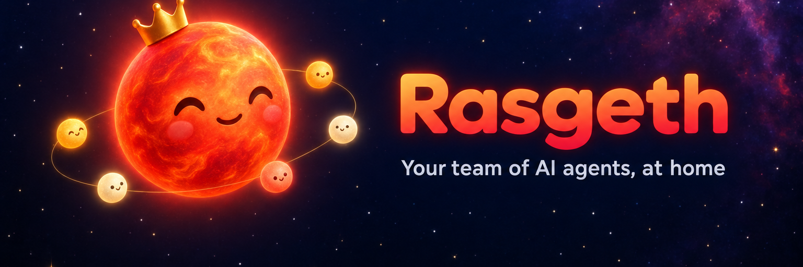
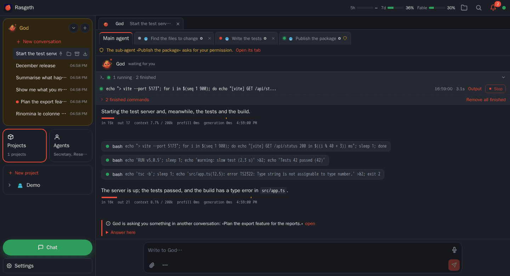
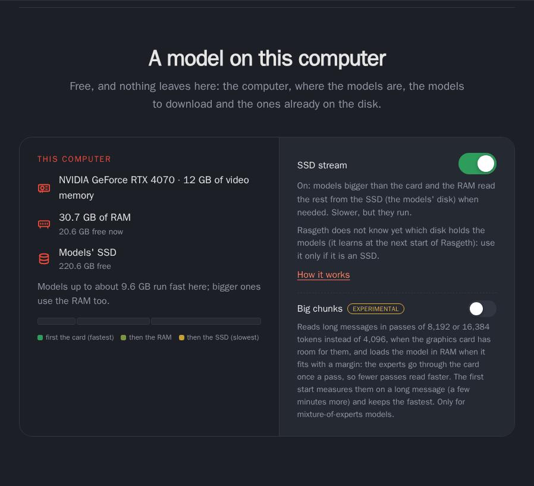
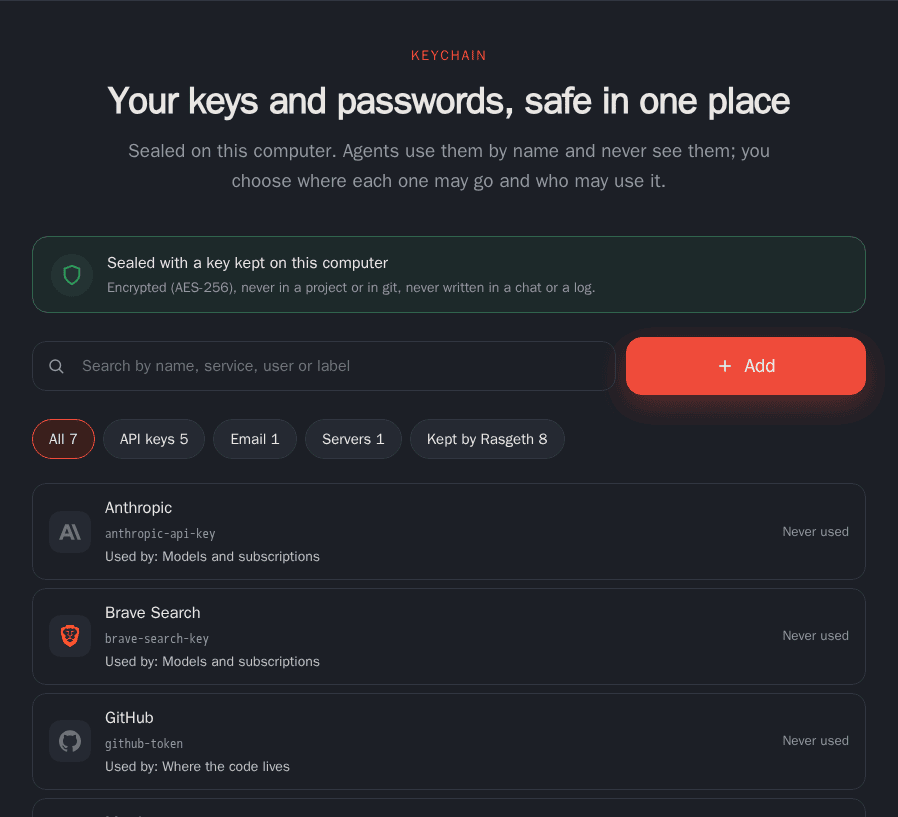
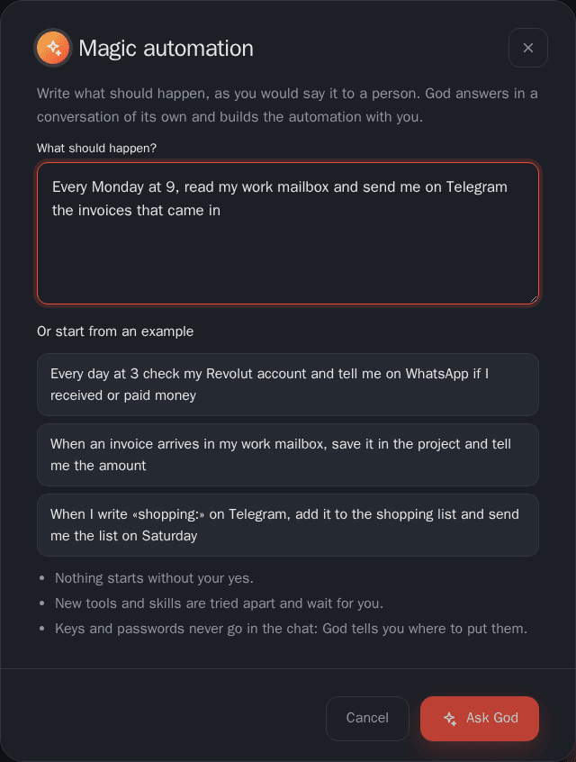
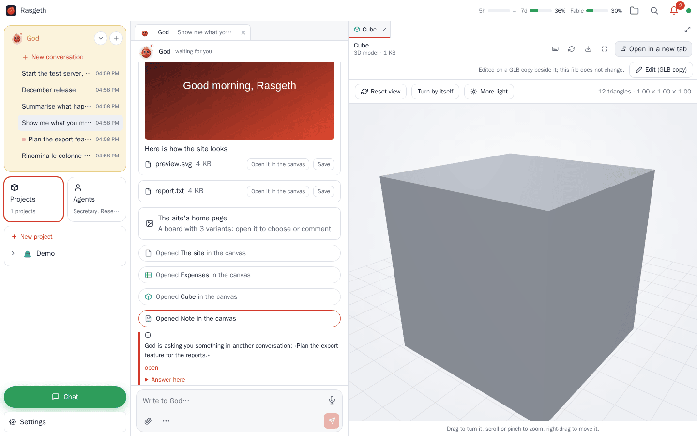
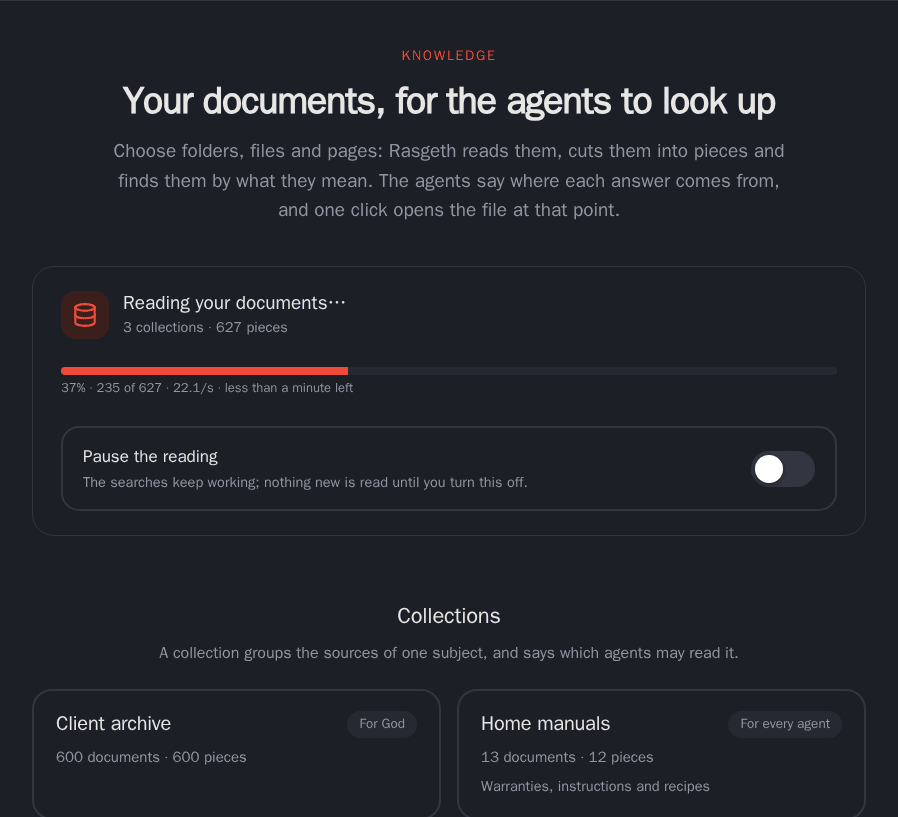
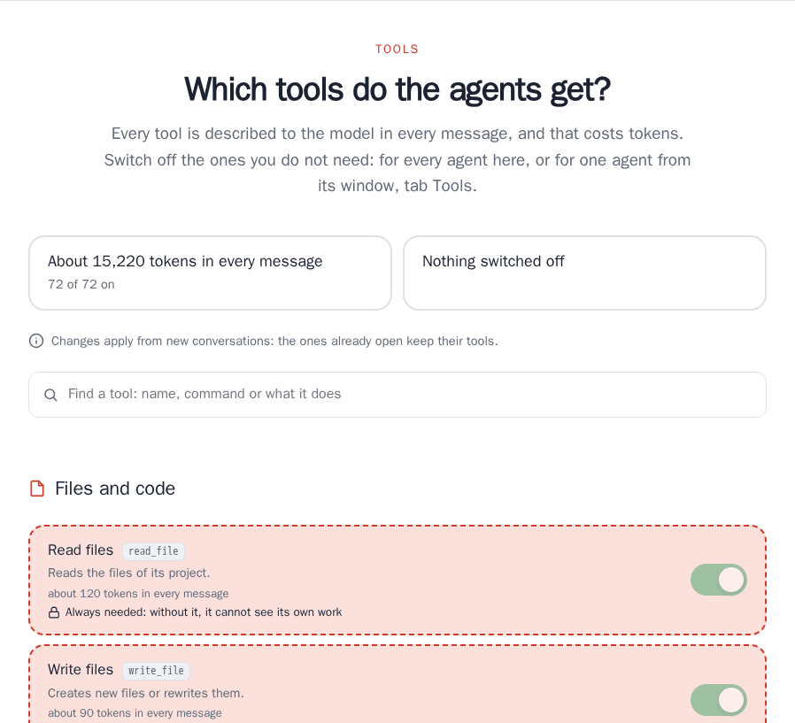
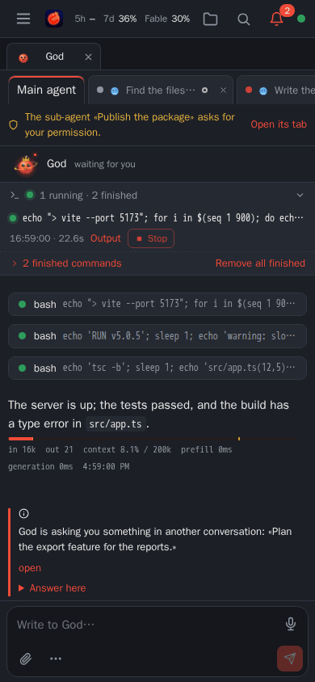

<p align="center">
  
</p>

<h1 align="center"> Rasgeth</h1>

<p align="center">
  <em>Rasgeth</em> is pronounced <strong>«ràs-ghet»</strong> (RAHS-get, with a hard g), after
  Rasalgethi, the star at the head of Hercules. It was called RedGiant until 3.8: same project, new name.
</p>

<p align="center">
  <strong>Your own AI team, on your own computer.</strong><br />
  One assistant you talk to from the browser, your phone or your chats, and a team of agents behind it
  that codes, automates and creates. MIT, no account, no paid tier.
</p>

<p align="center">
  <a href="https://github.com/Frostmoore/rasgeth/releases/latest"></a>
  <a href="LICENSE"></a>
  <a href="https://github.com/Frostmoore/rasgeth/actions/workflows/ci.yml"></a>
  <br />
  <a href="#windows">Windows</a> ·
  <a href="#macos">macOS</a> ·
  <a href="#linux-and-servers">Linux</a> ·
  <a href="#highlights">Highlights</a> ·
  <a href="docs/INSTALL.md">Docs</a> ·
  <a href="#roadmap">Roadmap</a>
</p>

<p align="center">
  <a href="docs/screenshots/team.png"></a>
</p>

|                                                                                                                                      |                                                                                                                                         |
| ------------------------------------------------------------------------------------------------------------------------------------ | --------------------------------------------------------------------------------------------------------------------------------------- |
| **Models bigger than your graphics card**<br />Bundled llama.cpp with Rasgeth's own patches; what does not fit is read from the SSD. | **A team, not a chatbot**<br />God plans, agents and sub-agents work, and a task is done only when its verifier exits 0.                |
| **A keychain the agents use blind**<br />Agents use keys by name and never see them; it fills your passwords in the browser too.     | **Automations in plain words**<br />Say what you want: God builds it, asks for what is missing and waits for your yes.                  |
| **Any file, in open formats**<br />Office, PDF, 3D and video open beside the chat; closed formats become open; agents drive Blender. | **Talk with your documents**<br />Folders, PDFs, pages, mail and chats indexed on your computer; answers cite their sources.            |
| **Safe by default**<br />A guardian asks before anything is written outside the project; every step goes to a tamper-evident log.    | **It improves itself, with a seatbelt**<br />God changes Rasgeth's code with tests and your yes; a broken version rolls back by itself. |

## Install

Native on Windows and macOS, Docker on Linux. Every download, for every system, is also on
**[rasgeth.it](https://rasgeth.it/)**. Questions: [info@rasgeth.it](mailto:info@rasgeth.it).

### Windows

Download **[Rasgeth-Setup.exe](https://github.com/Frostmoore/rasgeth/releases/latest/download/Rasgeth-Setup.exe)**
and run it: next, next, finish.

Everything runs directly on Windows: no WSL, no virtualization, no Docker. The installer brings its own
Node and database; the local engine (llama.cpp, CUDA or Vulkan) runs natively. Rasgeth opens the browser
already signed in and stays next to the clock; updates download only the files that changed. The
installer is not code-signed yet: if SmartScreen says "Windows protected your PC", click **More info**,
then **Run anyway**. Windows 10 2004 or newer, x64.

Why not signed? A code-signing certificate costs money every year, and Rasgeth is made by one person
who, for now, would rather spend it on the project. Every release is still signed with Rasgeth's own
update key, so Rasgeth only installs updates that really come from here. Donations are welcome: where
to send them is coming soon (on [rasgeth.it](https://rasgeth.it/)).

### macOS

Download **[Rasgeth-mac-arm64.dmg](https://github.com/Frostmoore/rasgeth/releases/latest/download/Rasgeth-mac-arm64.dmg)**,
open it and drag Rasgeth into Applications. It is signed and notarized by Apple, lives in the menu bar,
and runs local models on the GPU through Metal. Apple silicon, macOS 13 or newer.

### Linux and servers

```sh
curl -fsSL https://raw.githubusercontent.com/Frostmoore/rasgeth/main/install.sh | bash
```

It runs Rasgeth in Docker (Docker Engine 26+; the script offers to install it), everything in
`~/redgiant` (the folder keeps its technical name), and opens the browser already signed in.

### Rasgeth OS (a machine that only runs Rasgeth)

USB stick, Proxmox, Hyper-V, VirtualBox, VMware, clouds, a Raspberry Pi: see
[docs/INSTALL-OS.md](docs/INSTALL-OS.md). The OS images are made only when the OS itself changes, so
they sit on the latest release that carries them: the [latest release](https://github.com/Frostmoore/rasgeth/releases/latest)'s
notes link it, and the Proxmox script finds it by itself. A new machine updates itself to the latest
Rasgeth at its first start.

### Only the app

The Rasgeth app, for a computer or a phone that reaches a Rasgeth running somewhere else (a server,
Rasgeth OS, another PC). Rasgeth's own installers already carry it. On a computer it is called
**Rasgeth App**, so it is not mistaken for the whole Rasgeth installed beside it.

- **Windows**: [Rasgeth-App-Setup.exe](https://github.com/Frostmoore/rasgeth/releases/latest/download/Rasgeth-App-Setup.exe),
  for your user only, no administrator rights, with a Start menu entry and its own uninstallation.
- **Linux**: [rasgeth-app-linux-x64.tar.gz](https://github.com/Frostmoore/rasgeth/releases/latest/download/rasgeth-app-linux-x64.tar.gz):
  unpack it and run `./install-app.sh` (your user only, with a menu entry).

Their sha256 are listed in the release's `SHA256SUMS-companion`. The [site](https://rasgeth.it/download.html)
says what is ready for each system.

### First run

The setup in the browser asks one thing at a time: models (a subscription, API keys, your own server or
a local model), names, Telegram and the other chats, safety and costs. Coming from another agent? It
imports instructions, skills, memories and settings from Claude Code, Codex and Cursor, and the
conversations you exported from ChatGPT and Claude.

Options, updates, backups, uninstalling and every environment variable are in
[docs/INSTALL.md](docs/INSTALL.md).

## Rasgeth's own systems

Six things only Rasgeth does have a name of their own; everything else keeps its plain name (Knowledge,
Automations, the Keychain, Extensions…).

- **Constellation**: the team of agents in levels (God, the orchestrators, the agents and their
  sub-agents), each with its permissions, so a request climbs the levels and reaches you only when it has to.
- **Event Horizon**: the protections. Truly dangerous requests (system files, deletions for good, secrets
  leaving, real payments) always reach you, everywhere; the rest follows your choice, with a classifier
  that decides with its reason in the log, and a guardian on the project's folder.
- **Nebula**: the Canvas beside the chat, with real editors (documents, sheets, slides, pictures, video)
  that you and the agent use on the same file.
- **Deep Field**: local models bigger than the graphics card. What is used most stays on the card and in
  RAM, the rest comes from the SSD, and the next experts are loaded ahead while the current ones compute.
- **Filament**: the prompt-cache discipline. A conversation keeps the same prefix from start to end, its
  history only grows, like a thread, and a summary is an explicit event, so the cache keeps paying.
- **Persistar**: each conversation's context with a local model is saved on disk, so coming back to it,
  even after a restart, does not read everything again.

## Highlights

### Local models that outgrow your graphics card (Deep Field, Persistar)

<p align="center">
  
</p>

- llama.cpp comes bundled and native: CUDA or Vulkan on Windows, Metal on the Mac. Pick a GGUF from
  Hugging Face and Rasgeth estimates how fast it will run on your computer before you download it.
- **Deep Field** (_SSD stream_ in the settings): a model bigger than the card keeps what is used most on the card and in RAM and reads
  the rest from the SSD; for a mixture of experts, the experts leave the card and the ones used lately
  are cached there.
- Rasgeth's own llama.cpp patch ([`engine/llama-patches`](engine/llama-patches)) copies the next
  layer's experts to the card while it computes the current one, and bigger passes speed up long
  prompts (both experimental, off by default).
- **Persistar**: the KV cache is saved on disk and restored by prefix, even after a restart (inspired by
  [DwarfStar 4](https://github.com/antirez/ds4)), so a long conversation does not start over.

### Constellation: a team of agents, with tasks that are checked

- You talk to _God_, from the browser, your phone or a chat. God runs your projects; each project has an
  _orchestrator_ that creates agents (each in its own git worktree) and short-lived sub-agents, hands
  them tasks and merges their work.
- A task closes only through `complete_task` with a command that exits 0, or with a reason why it cannot
  be tested. An agent that stops early is reminded, and after three reminders the task is marked
  abandoned.
- Requests an agent cannot decide climb the hierarchy until they reach you, on the page and on every
  linked chat at once. A read-only _Inspector_ answers questions about a project without touching it,
  and rooms let several agents talk together.
- Each agent can have its own model and effort; a backup model retries a task an agent gave up on.
- A project you are done with can be archived: its agents stop, its automations pause, nothing can write
  into it, and it stays readable until you restore it, exactly as it was.

### The Keychain

<p align="center">
  
</p>

- A password manager built in: API keys, tokens and passwords sealed with AES-256 on your computer (the
  master key protected by Windows or the Mac's Keychain), never inside a project or a git repository.
  Every key Rasgeth itself keeps (providers, chats, mailboxes) lives here too.
- Agents use a credential by its name: Rasgeth puts the value on the request on its way out, only
  towards the hosts you allowed, and hides it in the answer. You choose who may use each one and whether
  to be asked; every use is recorded. A secret pasted in a chat is held back before it reaches a model.
- Import from Bitwarden, 1Password, Chrome, Edge and Firefox; a generator, expiry reminders, export
  sealed with a passphrase.
- [The browser extension](docs/INSTALL.md#the-keychain-in-your-browser) for Chrome, Edge, Brave, Opera
  and Firefox fills a sign-in form only on its own site, when you click, and saves new passwords.

### Magic: say it, and Rasgeth builds it

<p align="center">
  
</p>

You describe what you want in your own words. God, the agent that runs Rasgeth, asks what it needs,
writes what is missing with its tests, tries it in a closed sandbox and shows you the result. Nothing
starts and nothing installs until you say yes, and keys never go in the chat: they go into your
Keychain and reach only the sites the new piece declared.

**Magic automations**: things that happen on their own.

- «Every morning at 8, read the invoices that arrived in my work mailbox, put them in a spreadsheet
  with supplier, date and amount, and tell me the total on Telegram.»
- «When I drop photos in the Holidays folder, rename them with the date they were taken and sort them
  by month.»
- «Every Monday check every link on my website and send me the broken ones.»
- «When I write "shopping:" on Telegram, add it to the list and send me the list on Saturday.»

Automations start at a time, on a webhook, an email, a chat message, files changing, another
automation or a task ending, with conditions, your approval before they act, a budget, retries, and
the result delivered on any chat or by email ([recipes](recipes/README.md)). Approval waits until
every chat, mailbox, key or tool it needs is there. Plain reminders cost nothing.

**Magic integrations**: connect the agents to a service you use.

- «Connect me to Notion: search my pages and create new ones.»
- «Connect to my invoicing software's API: invoices and customers.»
- «Read my Todoist tasks and mark them done.»

God writes the connector with its tests and tries it against the service in the sandbox; you add the
key from a window of its own, and from then on every agent can use it (unless you switch it off).

**Magic extensions**: a new tool or skill for the agents.

- «Turn an invoice PDF into a CSV row.»
- «Check an Italian VAT number and give me the company's name and address.»
- «Add up the columns of a CSV and draw a chart.»

You see the package before it installs: what it adds, which sites it may reach (or none), its code
and its tests, with _Approve and install_ off until every test passes.

### Nebula, the Canvas: any file, in open formats



- Ask an agent to show you a file and it opens beside the chat: video and audio with a player, PDF,
  Word, Excel and PowerPoint laid out as they print, 3D models to turn, archives, fonts, code and data.
  The agent can look at the Canvas too, and point you to a cell or a line.
- Edit there too, with the agent in the same editor: code, Markdown, JSON, YAML and XML; spreadsheets
  (CSV, ODS, and an open copy of an XLSX that keeps charts and pivots); documents and slides with
  LibreOffice in the page (Chromium over HTTPS or on this computer; elsewhere a paged preview with the
  edits made by LibreOffice on the server). Every change, yours or the agent's, shows who made it and can
  be undone, one change or the agent's whole turn; agents can also just propose their changes.
- PDF: highlight, notes, text boxes, drawings, signatures and forms; rotate, move and remove pages. The
  original stays untouched at the start of the file, and redaction really removes what lies under it.
  SVG: shapes, paths, text, groups and Inkscape layers, saved without losing what Inkscape wrote.
- Agents work only on open formats. Closed files are converted beside the original, keeping the layout:
  IDML into Scribus or ODG, Sketch into SVG, PSD into OpenRaster with its layers, Office files into ODF.
  The free programs this needs are downloaded the first time
  ([which ones](docs/INSTALL.md#programs-downloaded-when-needed)).
- Blender for the agents: build or change 3D models with a script, convert them to glTF, render a picture
  or a turntable video.

### Knowledge

<p align="center">
  
</p>

- Folders, files (scanned PDFs too, with OCR on your computer), web pages, and, if you want, mail and
  chats are indexed in Rasgeth's own Postgres (pgvector, with the embeddings you choose, local or
  cloud). Search goes by words, and by meaning too once you pick an embedding model; answers cite the
  file, page and line, and one click opens it there.
- A collection belongs to one agent, a project or everyone. Agents can create collections and add
  sources themselves; you add them by picking, uploading or dropping files. After solving a problem an
  agent can propose a skill from what it learned.

### Tools and costs in plain sight

<p align="center">
  
</p>

- The Tools page lists every tool the agents get, what it does and how many tokens it adds to each
  message. Switch tools off for every agent or one by one; essential tools stay on and say why. An
  agent missing a tool asks you for it by name.
- Every message shows tokens read, cached and generated, context use and timings; budgets per agent, per
  project and overall. The prompt prefix stays stable (Filament), so caching keeps costs down.
- `find_files` finds files and programs anywhere on the computer in seconds (the system's index when
  there is one, the likely places first otherwise), instead of an agent walking the whole disk.

### Event Horizon: safe by default

- Agents work in the project's folder with a guardian: writing outside it asks you. Docker sandboxes
  with an egress proxy are there for servers that want them.
- Permission modes (manual, auto, plan, read-only), a danger classifier, and requests with a time limit
  you choose. A failure or a timeout never counts as "allow", and truly dangerous requests (system files,
  deletions for good, secrets leaving, real payments) always reach you.
- An append-only, hash-chained event log of everything agents do: the source for replay, audit and
  tests.
- God can change Rasgeth itself: code changes go through a git worktree, tests and a trial copy with no
  secrets, you approve them, and the supervisor rolls back by itself if the new version does not come
  up. Configuration changes are undoable.

### Any model, everywhere you are



- Flat subscriptions: **Claude** (through Anthropic's Claude Agent SDK) and **ChatGPT** (through OpenAI's
  Codex app server), with the plan's 5-hour and 7-day limits in the header. Using a personal
  subscription in a third-party tool may not be allowed by the provider's terms: Rasgeth links them and
  asks you to read them before you turn it on.
- API keys for Anthropic, OpenAI, Gemini, Mistral, DeepSeek, xAI, Groq, OpenRouter, Together, Fireworks
  and Cerebras, and any OpenAI-compatible server of your own (vLLM, Ollama, llama.cpp…).
- Telegram, WhatsApp, Discord, Slack, Signal and Matrix, plus Microsoft Teams and iMessage (new in 3.4,
  not yet tried on real accounts), with voice messages transcribed, pictures and files. On Telegram,
  questions and approvals come with buttons.
- A phone layout installable as an app (PWA), reachable from outside home through Tailscale, Cloudflare
  or your own domain. Web search through SearXNG (started by Rasgeth on its own) or Brave, Tavily, Exa
  and Serper.
- A shared memory of what Rasgeth knows about you, learned from your own messages (never a secret,
  every change undoable), and a backup of everything in one file.

<br clear="right" />

<sub>Screenshots from the demo server (`packages/web/scripts/demo-server.mjs`: a scripted model and
simulated hardware), taken with `packages/web/scripts/readme-shots.mjs`.</sub>

## How it works

```
Telegram, WhatsApp… → Demi-God → God → projects → orchestrator → agents → sub-agents
                                  └── Chat, personal assistants
```

_Demi-God_ is God's spokesperson on the chats: it relays to God and nothing else. _God_ is the platform
agent: it creates projects, configures Rasgeth and answers to you. Each project has an _orchestrator_
that creates persistent _agents_ and short-lived _sub-agents_, delegates tasks and merges their work.
Beside the hierarchy there is the _Chat_, the everyday assistant, and personal assistants with the
services you give them. Agents only see what their scope allows.

Under the hood: a TypeScript server (HTTP + WebSocket, OpenAPI at `/api/openapi.json`), Postgres for the
event log, the board and the state (its own, embedded, on Windows and the Mac), and a supervisor that
rebuilds and rolls back. There is also a `rasgeth` command-line client (and `rasgeth-acp`, for editors that speak
[ACP](docs/acp.md)).

## How well it works

Rasgeth ships an evaluation suite: coding tasks with hidden verifiers, each run by a real project
orchestrator. On the current eight tasks, Claude Sonnet 5.5 and Claude Opus 5.5 both pass **8/8**
(costs, tokens and times in [docs/evals.md](docs/evals.md)). Run it on your own models with
`pnpm --filter @redgiant/evals start -- --models provider/model`.

Against other harnesses, with the same model (Claude Haiku 5.5) on the same tasks:

| Harness     | SWE-bench Verified (50) | Aider Polyglot (225) | Cost      |
| ----------- | ----------------------- | -------------------- | --------- |
| Rasgeth     | 42/50                   | 220/225              | **$1.69** |
| OpenHands   | 44/50                   | 224/225              | $1.85     |
| Claude Code | 42/50                   | 210/225              | $3.13     |

Rasgeth costs the least. One run, with caveats that matter (a network outage, three Windows fixes
that came after it): [docs/benchmark.md](docs/benchmark.md).

## Privacy

Rasgeth sends no telemetry. It contacts GitHub to look for updates, downloads the free programs a
feature needs the first time you use it, and the models you choose. Everything else goes only to the
model providers, chats and services you connect yourself; with a local model, your conversations never
leave your computer.

## Roadmap

Rasgeth is in pre-alpha. What comes next, in order:

- **3.4 — Knowledge** (released): talk with your documents with citations; import from Claude Code,
  Codex, Cursor and exported chats; skills that write themselves; Matrix, Teams and iMessage; the
  Keychain in your browser; smaller, signed updates. The 3.4.x releases bring the fixes from real use.
- **3.5 — Editor** (released: code and text, spreadsheets, documents and slides, PDF, vector drawings,
  layered images with Photoshop-like tools, 3D models, artifacts and widgets): a real editor in the Canvas for
  every file it can open, with the agent working in the same editor as you, on a computer, a tablet or a
  phone, by mouse, touch or keyboard.
- **3.6 — Long arms** (released): SSH to other machines, integrations and extensions created on request, email
  for the agents, hands-free voice, ACP both ways (Rasgeth inside editors, other
  agents as workers), and artifacts that can ask the agent, keep their data and read project files.
- **3.7 — Rasgeth everywhere** (released): Rasgeth OS, a ready-made system for any machine — a USB stick
  installer, Proxmox (a container or a virtual machine, with a one-line script), Hyper-V, VirtualBox and VMware,
  Raspberry Pi — headless, with Wi-Fi, HTTPS at home and updates from the page; your Rasgeths joined as nodes;
  the first sign-in is just «create your access»; and a guide for those who already have a proxy, a VPN and a
  home DNS.
- **3.8 — Native apps**: the app, one Flutter app for Android, iOS, Windows, macOS and Linux, with its
  own agent-first look (every agent has its own mascot) and an advanced mode for coders. 3.8.0 (released) lays the
  ground: Rasgeth OS opens its own temporary Wi-Fi at the first start, so a mini PC with no screen is set up from
  a phone or a laptop; devices with their own revocable access; push notifications; the mascots, already in the
  page. 3.8.1 (released) brings the app itself: for the phone (Android; iOS prepared) and, through the
  launchers, for Windows, macOS and Linux — the team with live mascots, chats, requests, tasks, the Canvas, notifications,
  voice, sharing, Saved passages and the advanced mode — plus product cards with pictures and clearer updates.
  3.8.2 (released) gives the computers an interface of their own, the control room (the wall of agents, the
  Ctrl/Cmd+K search, projects with diffs, terminals, git as a graph, the log), every answer's figures in the app,
  updates followed from the app, an icon, the app on its own for Windows and a site for the downloads.
  3.8.3 (released) opens conversations in the whole window with the mascots' bar, shows spending and limits at the top of the app's conversations, sends with Ctrl/Cmd+Enter, attaches files and
  screenshots with Ctrl/Cmd+V and puts «New project» and «New agent» on the control room's walls. 3.8.4 (released) fixes the header of a chat
  opened from the Chat card and the version the update screen announces. 3.8.5 (released) gives the app
  a full-width place to write, with its buttons inside, and a red cursor that follows the answer being written. 3.8.6 (released) keeps
  the phone and the computer in step, live. 3.8.7 (released) starts making the app do everything the page does: the
  whole conversation, the turn, widgets and artifacts, agent settings from the agent, every setting inside the app,
  and a warmer Chat. 3.8.8 (released) makes widgets look like small apps and fixes writing to God after an
  update and the figures of the ChatGPT subscription. 3.8.9 (released) asks only for what is really dangerous, explains
  every request in one line and picks up interrupted work after a restart.
  3.8.10 (released) keeps every list live everywhere, gives the app menus and conversations for every agent, pauses,
  resumes, removes and restores agents, and lets you choose how many work at once. 3.8.11 (released) opens the Canvas by itself in the
  app, brings the project's files into the conversation and adds boards, ports and artifacts. 3.8.12 (released) brings the
  whole team, every-day settings, projects, sub-projects and the terminal into the app. 3.8.13 (released) gives the app's
  Canvas the page's viewers, sets a sub-agent limit per project and lets the app update itself. 3.8.14 (released) brings
  every editor, automations, knowledge and shared memory into the app.
- **3.9 — Rasgeth** (3.9.0, 3.9.2–3.9.9 released; 3.9.2 redraws God and the Demigod and starts without internet; 3.9.3 shows pictures in the chat and lets the model's own image tool go first; 3.9.4 adds the person's portrait, lighter agents with tools switched on by group, and the parent's ring for sub-agents; 3.9.5 makes questions wait for the person, fixes the Windows app's self-update and stops taking links for secrets; 3.9.6 searches past conversations; 3.9.7 lets skills improve with use, with the person's approval; 3.9.8 keeps pasted passwords out of the chat, asks less and makes subscriptions work everywhere; 3.9.9 gives the inspector its tools on a subscription): RedGiant and its app become Rasgeth. A new name, a new icon (a crowned star in
  the night sky) at every size on every system, the app called Rasgeth too («Rasgeth App» on a computer,
  beside the whole Rasgeth), new file names for every download, the `rasgeth` command and the site
  [rasgeth.it](https://rasgeth.it/). The data stay where they are; moving over is a clean install that the
  page guides, with a checked backup first.
- **3.10 — Video, the whole app, and 3D generation** (3.10.0–3.10.5 released: the video editor and its second part, and the app doing natively everything the page does, then a fingerprint before a password and a quicker inspector, the app in the tray and the wake word in the app, then names for Rasgeth's own systems on the page, in the app and here, then answers easier to read, an accent colour of your choice and a reply that never scrolls away under your finger; 3D generation follows): a video editor
  with tracks, shared by you and the agent. The agent assembles a first cut from your clips (words, silences,
  speech or cover shots), writes the subtitles and puts music under them that dips when someone speaks; you
  cut, move clips across tracks, trim with ripple, make J- and L-cuts, add transitions, titles and Ken Burns,
  with Resolve's keys, and ask the agent about the very clip you chose. The video is made where you choose,
  this machine or a node with its graphics card (NVENC), and the timeline opens in DaVinci Resolve (XML) or
  any OpenTimelineIO tool. The same editor in the app, with its keys, files dragged from its tree and the
  render in the system's notifications. Part two adds keyframes and picture in picture, colour and LUTs,
  cuts on the beat, slip/slide/roll, speed and still frames, and Resolve timelines in. Then 3D generation with local or cloud engines, finished in Blender.
- **3.12 — Simple interface**: an assistant for everyone, with no technical words in view (the full interface
  one switch away), God's conversations sorted by topic, and your own rules in Settings › Rules.
- **3.12.1 — God and Satellite, emulators**: God big at home with Satellite, the Chat, on its orbit, your agents at
  the bottom, God writing first now and then; Android emulators in the Canvas, for you and the agents.
- **3.12.2 — Search in the conversation, iOS**: images, products, trains and flights, routes as widgets inside the
  answers; iPhone and iPad simulators in the Canvas; the simple interface with stop, attach and a floating strip.
- **3.12.3 — Ready settings for agents**: research, email, messages, spreadsheets and diary set up well from the
  start, with any number of mailboxes, chats and calendars per agent; orchestrators that lead a team; topics from
  Telegram too.
- **3.12.4 — A secretary that answers people**: the message secretary answers contacts on Telegram and WhatsApp
  Business within what it was told, with a step-by-step guide to connect WhatsApp Business.
- **4.0 — Alpha**: documentation, security and privacy pages, and a stability round on everything.
- **Then** the beta (community, documentation site) and the production release.

## Documentation

| Goal                                                                        | Start here                                                      |
| --------------------------------------------------------------------------- | --------------------------------------------------------------- |
| Install, options, environment variables, updates, backups                   | [docs/INSTALL.md](docs/INSTALL.md)                              |
| The Keychain in your browser                                                | [docs/INSTALL.md](docs/INSTALL.md#the-keychain-in-your-browser) |
| Running from source, the packages                                           | [docs/INSTALL.md](docs/INSTALL.md#running-from-source)          |
| Evaluation results and tasks                                                | [docs/evals.md](docs/evals.md)                                  |
| Rasgeth, Claude Code and OpenHands on SWE-bench Verified and Aider Polyglot | [docs/benchmark.md](docs/benchmark.md)                          |
| Writing automations                                                         | [recipes/README.md](recipes/README.md)                          |

## Contributing

Issues and pull requests are welcome; the ground rules are in [CONTRIBUTING.md](CONTRIBUTING.md).
Requirements: Node.js 22+ and pnpm (`corepack enable`).

```sh
pnpm install
pnpm build    # tsc -b, then the web page and the browser extension
pnpm test     # vitest; tests never call a real model
pnpm lint     # Biome (pnpm format to fix formatting)

# optional, spends real tokens:
ANTHROPIC_API_KEY=... pnpm test:live
REDGIANT_LIVE_OPENAI_BASE_URL=http://localhost:8080/v1 pnpm test:live

# optional, needs Docker:
docker build -t redgiant/sandbox:dev -f docker/sandbox.Dockerfile docker
REDGIANT_DOCKER_TESTS=1 pnpm test:docker

# web UI against a demo server (scripted model, in-process Postgres):
pnpm build && node packages/web/scripts/demo-server.mjs 7650   # then open http://localhost:7650
```

The repository is a pnpm monorepo with its packages in `packages/`; what each one does is in
[docs/INSTALL.md](docs/INSTALL.md#packages). Notes for coding agents (and humans) are in
[CLAUDE.md](CLAUDE.md).

## License

[MIT](LICENSE). Use it, change it, sell it. No account, no paid tier.
