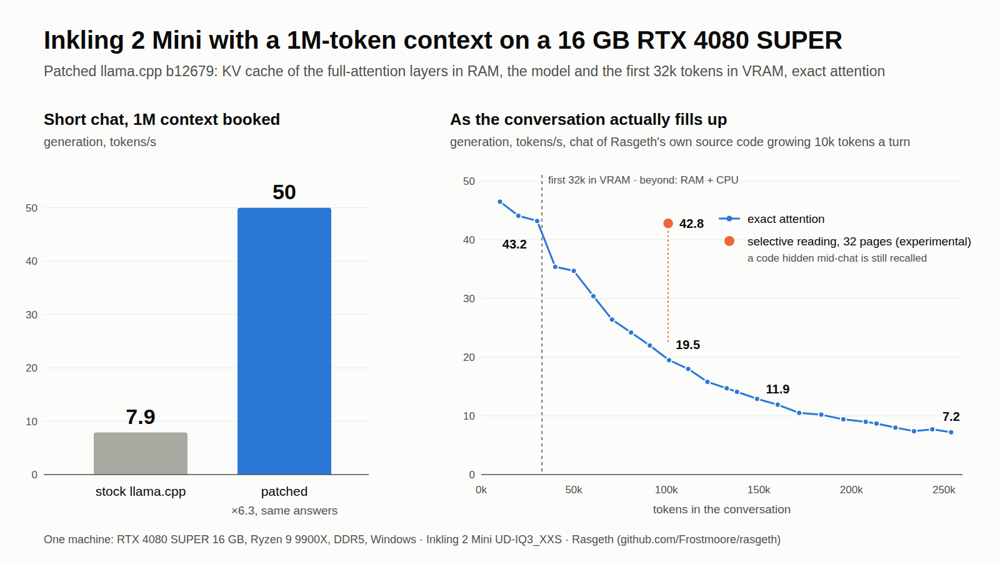

# Long context on a 16 GB card: the model in VRAM, the KV cache in RAM, exact attention

How Rasgeth runs local models with sliding-window layers (Inkling 2 Mini, Gemma 4) with a context of up to a
million tokens on a 16 GB graphics card, what we measured, and what did not work. Rasgeth 3.13.0, engine patch
[`engine/llama-patches/0003-redgiant-kv-host.patch`](../engine/llama-patches/0003-redgiant-kv-host.patch) on
llama.cpp b12679 (applied after 0001 and 0002). Measured on one machine on 2026-11-27/28: NVIDIA RTX 4080 SUPER
16 GB, AMD Ryzen 9 9900X (12 cores), 64 GB DDR5, Windows; model Inkling 2 Mini UD-IQ3_XXS (26B MoE, 3.4B active,
11.7 GB). Speeds in tokens per second: _generation_ is the answer, _prompt_ is reading the message.

## 1. The problem

llama.cpp books the whole KV cache in VRAM when the engine starts. On a 16 GB card a context of 256k-1M tokens does
not fit next to the model, so `--fit` moves MoE experts to the CPU, and generation drops 5-8 times **even for a short
conversation**: Inkling 2 Mini writes 50 t/s with 32k booked, 7.9 t/s with 1M booked.

| Inkling 2 Mini, short conversation, stock llama.cpp | Generation | Prompt |
| --------------------------------------------------- | ---------- | ------ |
| 64k booked (fits)                                   | 53.2       | 340    |
| 256k booked                                         | 7.6        | 52     |
| 512k booked                                         | 8.2        | 55     |
| 1M booked                                           | 7.9        | 40     |

## 2. The idea

In a model with sliding-window layers only the full-context layers' cache grows with the context (Inkling: 8 of its 48
attention passes; the other 40 keep the last 1 024 tokens). So:

1. **The full-context layers keep their KV cache in pinned RAM** (`LLAMA_KV_FULL_HOST`); the model and the
   sliding-window layers stay in VRAM. A long context booked costs RAM, not VRAM, and only the cells in use are read.
2. **Our attention on the CPU** for those layers (`LLAMA_KV_FULL_HOST=2`): ggml's CPU flash attention reads the cache
   once per query head and row by row (~8 GB/s here); ours reads every kv head of a cell together, with AVX-512 VNNI for
   the keys, at 49-60 GB/s (a plain version for CPUs without AVX-512 VNNI, chosen at run time).
3. **The first cells in VRAM too** (`LLAMA_KV_HOT_CELLS=N`): a copy of the first N cells of those layers stays in
   VRAM, every new token is written to both. While the conversation fits in N, the GPU attends as the stock engine
   does. Past N the CPU attends to cells N..end, and **its result enters the GPU's flash attention as extra rows**:
   for every query head, a row with a key of zero, the CPU's normalized output as value, and in the mask the log of
   the CPU's softmax sum (minus infinity for the other heads). The softmax over hot cells plus those rows is the
   softmax over every cell: the result is exact, and the CUDA kernels are untouched.

After an operation that moves cells (a shift, a saved slot restored) the VRAM copy is copied again from RAM.

## 3. What made the difference

| Change                                              | Why                                                                                                                          | Effect                                                    |
| --------------------------------------------------- | ---------------------------------------------------------------------------------------------------------------------------- | --------------------------------------------------------- |
| Cache in RAM, model in VRAM                         | no more experts pushed to the CPU                                                                                            | 1M booked, short chat: 7.9 → **50** t/s                   |
| Our CPU attention                                   | reads the cache in order, VNNI                                                                                               | long prompt, 1M booked: 27 → 40 t/s generation            |
| First cells in VRAM, CPU result as extra rows       | the GPU keeps the recent part, exact merge                                                                                   | long prompt: 44.8 t/s, prompt 502 t/s (stock: 4.7 and 44) |
| `ggml_backend_sched_reserve_size` without the reset | the reset dropped backends set on nodes, so `--fit`'s dry run counted CPU nodes in VRAM (12.7 GiB at 1M)                     | `--fit` keeps the model in VRAM                           |
| Inkling's relative-bias mask in two parts           | the hot part built in VRAM, the cold part never built: the CPU derives it cell by cell from the bias table and the distances | prompt at 30k: 83 → 327 t/s                               |
| A matrix kernel for prompt processing               | keys repacked so one VNNI instruction scores a query against 16 cells; 4 queries × 64 dims in registers                      | 64 rows over 18k cold cells: 111 → 16 ms per layer        |
| Vectorized query quantization                       | `lrint` is a slow C runtime call on Windows                                                                                  | generation: 2.0 → 0.9 ms per layer at 18k cold cells      |

## 4. A conversation that actually fills up

Each turn pastes ~10k tokens of Rasgeth's own source code and asks what it does; same slot, prompt cache on. 32k
cells in VRAM.

| Conversation | Generation | Prompt | A 10k-token turn |
| ------------ | ---------- | ------ | ---------------- |
| 10k          | 46.5       | 509    | 22 s             |
| 30k          | 43.2       | 327    | 34 s             |
| 60k          | 30.4       | 190    | 59 s             |
| 100k         | 19.5       | 111    | 98 s             |
| 150k         | 12.9       | 72     | 161 s            |
| 200k         | 9.0        | 51     | 242 s            |
| 254k         | 7.2        | 37     | 286 s            |

Past the VRAM copy the limit is how fast the CPU reads RAM: every generated token reads the whole cold part of 8
layers.

## 5. Quality

- **Same tokens as stock** (temperature 0, top probabilities compared token by token, 2 048 cells in VRAM so a
  6 500-token prompt is mostly in RAM): 60 of 60 tokens identical on the long document; other prompts diverge only
  where the two best candidates are within a few hundredths of probability (0.324 vs 0.318).
- **A needle in a 101k-token conversation**, placed mid-conversation (~55k, in the RAM part): recalled exactly.

## 6. Further tests

| Test                                                                                                                                                                                                                            | Result                                                                                      | Verdict                 |
| ------------------------------------------------------------------------------------------------------------------------------------------------------------------------------------------------------------------------------- | ------------------------------------------------------------------------------------------- | ----------------------- |
| 48k cells in VRAM instead of 32k                                                                                                                                                                                                | full speed up to 48k (40k: 35.4 → 46.0 t/s), +10-15% beyond; VRAM 14.3 GB, no stalls        | worth it, with a margin |
| **Selective reading**, 32 pages of 64 cells (`LLAMA_KV_SELECT=32`, generation only, Quest-style: per page the min/max of every key dimension, read the pages whose best possible score is highest, plus the first and last two) | at 100k: 19.8 → **42.8 t/s**; the mid-conversation needle still recalled                    | promising, experimental |
| Selective reading, 8 pages                                                                                                                                                                                                      | 43.9 t/s, but the needle only appears in the model's reasoning, no answer within 600 tokens | too little read         |
| KV cache at 4 bits (`q4_0`, supported by the kernels)                                                                                                                                                                           | +10-15% inside VRAM and past 100k, ~+5% in between; tokens diverge from stock earlier       | an option at most       |

## 7. What did not help

| Test                                                 | Why not                                                                      |
| ---------------------------------------------------- | ---------------------------------------------------------------------------- |
| Stock `--no-kv-offload` (all KV in RAM)              | ggml's CPU attention is slow: 6.7-12.7 t/s                                   |
| The GPU reading the cold cells over PCIe (zero-copy) | 20-30× slower than the CPU reading them                                      |
| Overlapping GPU and CPU work                         | the GPU's own part is under 0.5 ms per layer: 3-5% at best                   |
| 64k cells in VRAM on 16 GB                           | the card fills up, Windows pages VRAM out: 23 t/s                            |
| Large prompt batches with Inkling (`-ub` 4096+)      | its relative attention's scratch grows with batch × context: 58-220 GB asked |

## 8. Limits

One machine, Windows. Linux and other cards are untested. The VRAM copy and our CPU kernels need Q8_0 or Q4_0 KV and
heads of 128 (Gemma 4's full-context layers have 256: there only the cache in RAM applies). Selective reading was
checked with one needle in one conversation, and its page summaries are not invalidated if the cold cells are reused
by another conversation. One stream (`--kv-unified`).

## 9. How to try it

- **In Rasgeth:** Settings › Models › a local model's card › Improvements › **Long context** (NVIDIA cards, models
  with sliding-window layers). Rasgeth computes how many cells stay in VRAM from the model, the card and a margin.
- **llama.cpp by hand:** apply the three patches of `engine/llama-patches` (`apply.sh` / `apply.ps1`) on b12679, then
  `LLAMA_KV_FULL_HOST=2 LLAMA_KV_HOT_CELLS=32768 llama-server -m <model> -ctk q8_0 -ctv q8_0 -c 1048576 --kv-unified ...`
  (`LLAMA_KV_SELECT=32` for the experimental selective reading).
